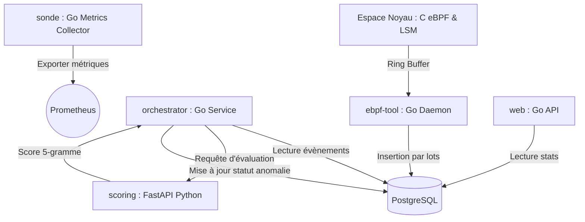

# Block-X

**Block-X** est un système de détection d'intrusion basé sur l'hôte (HIDS) hybride et léger pour Linux. Il associe la puissance d'**eBPF** et des **Linux Security Modules (LSM)** à un modèle d'analyse statistique en espace utilisateur pour surveiller la télémétrie des processus en temps réel et bloquer proactivement les accès non autorisés aux ressources sensibles.

---

## 🏗️ Architecture du Système

Le projet est divisé en trois couches fonctionnelles principales :



1. **Espace Noyau (Kernel Space)** :
   - Code C eBPF interceptant la télémétrie via des *tracepoints*.
   - Hook LSM (`lsm/file_open`) pour le contrôle d'accès proactif sans vulnérabilités de type TOCTOU.
2. **Couche d'Ingestion & d'Orchestration (Go Userspace)** :
   - [ebpf-tool](file:///home/monga/code/go/block-x/ebpf-tool) : Charge les programmes eBPF, traduit les politiques de sécurité du fichier YAML vers les maps eBPF, et persiste les évènements reçus du Ring Buffer dans PostgreSQL.
   - [orchestrator](file:///home/monga/code/go/block-x/orchestrator) : Service d'arrière-plan traitant asynchronement les journaux SQL pour les faire évaluer par le service analytique.
   - [sonde](file:///home/monga/code/go/block-x/sonde) : Exporte les métriques physiques de la machine pour Prometheus.
   - [web](file:///home/monga/code/go/block-x/web) : Expose une API REST en Go pour interroger les données collectées.
3. **Couche Analytique (Python Userspace)** :
   - [scoring](file:///home/monga/code/go/block-x/scoring) : Service FastAPI appliquant un modèle statistique à 5-grammes (avec lissage Add-k) pour évaluer la dangerosité des séquences d'appels système.

---

## 📁 Structure du Projet

```text
block-x/
├── ebpf-tool/       # Sonde eBPF & démon d'ingestion de télémétrie (Go / C)
├── orchestrator/    # Orchestrateur d'analyse asynchrone des évènements (Go)
├── scoring/         # Service d'évaluation comportementale par N-grammes (Python / FastAPI)
├── sonde/           # Service de collecte de métriques système (Go)
├── web/             # API web pour la visualisation et l'accès aux logs (Go)
└── monographie_block_x.tex # Rapport universitaire détaillé de conception et d'implémentation
```

---

## 🛠️ Prérequis

- **Système d'exploitation** : Linux (Noyau $\ge$ 5.8 requis pour le Ring Buffer eBPF et le support LSM).
- **Compilateur BPF** : `clang`, `llvm`, `libbpf-dev`.
- **Langages** : Go $\ge$ 1.21, Python $\ge$ 3.8.
- **Base de données** : PostgreSQL.

---

## 🚀 Installation & Démarrage

### 1. Base de données
Créez la base de données PostgreSQL et appliquez le schéma d'initialisation disponible dans [database_migration.sql](file:///home/monga/code/go/block-x/scoring/database_migration.sql) :
```bash
psql -U <utilisateur> -d <base_de_données> -f scoring/database_migration.sql
```

### 2. Service d'Analyse (Scoring)
Installez les dépendances Python et lancez l'API FastAPI :
```bash
cd scoring
python3 -m venv venv
source venv/bin/activate
pip install -r requirements.txt
uvicorn main:app --host 127.0.0.1 --port 8000
```

### 3. Agent d'Ingestion (ebpf-tool)
Configurez vos règles de sécurité dans [config.yaml](file:///home/monga/code/go/block-x/ebpf-tool/config.yaml). Générez ensuite le bytecode eBPF puis compilez l'outil Go :
```bash
cd ebpf-tool
make gen
make build
# L'exécution nécessite les privilèges root pour charger les programmes eBPF
sudo ./build/block-x
```

### 4. Orchestrateur
Compilez et lancez l'orchestrateur pour traiter les évènements en arrière-plan :
```bash
cd orchestrator
go build -o orchestrator-bin cmd/main.go
./orchestrator-bin
```

### 5. API Web & Sonde (Facultatif)
Pour exposer les données et collecter les métriques matérielles :
```bash
# Pour la sonde
cd sonde
go build -o sonde cmd/main.go
./sonde

# Pour l'API Web
cd web
go build -o web-server cmd/main.go
./web-server
```

---

## ⚙️ Configuration

La politique d'accès aux fichiers et répertoires est définie de manière déclarative dans le fichier [config.yaml](file:///home/monga/code/go/block-x/ebpf-tool/config.yaml) :

```yaml
restricted_files:
  - paths:
      - "/etc/shadow"
    read:
      allow:
        user_uid: [0]
        binary_paths: ["/bin/cat"]
    write:
      allow: null # Bloque toute écriture, même par root
```

---

## 📊 Performances

Les mesures de performances et l'analyse théorique détaillée du système sont consignées dans la monographie du projet ([monographie_block_x.tex](file:///home/monga/code/go/block-x/monographie_block_x.tex)). 

- **Surcharge CPU** : $< 1,8\,\%$ sous forte charge.
- **Empreinte Mémoire** : Stabilisée à $\approx 43\text{ Mo}$ en espace utilisateur grâce à l'utilisation de caches LRU et d'un nettoyage actif à la terminaison des processus.
