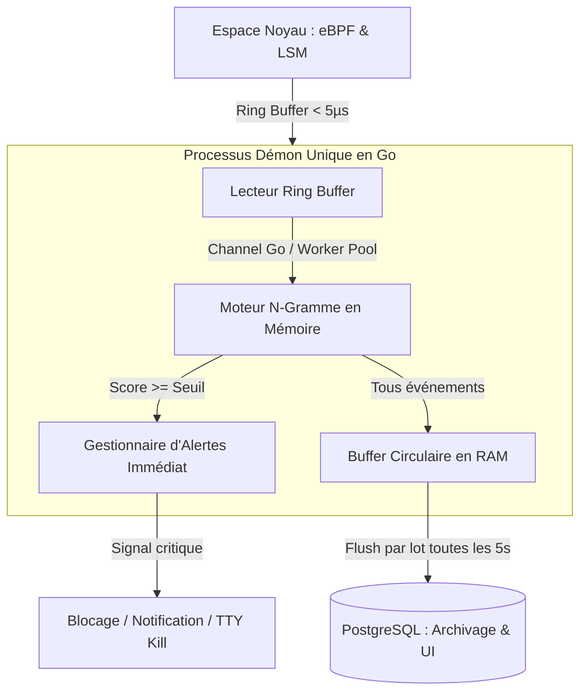
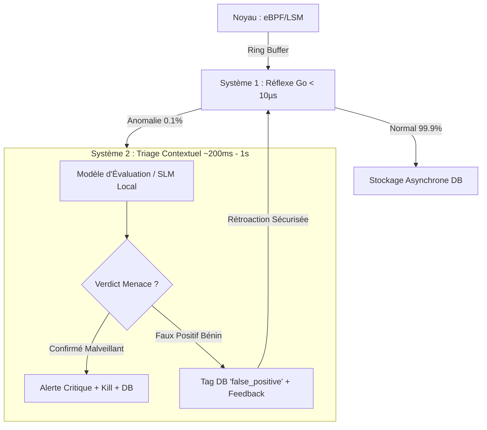
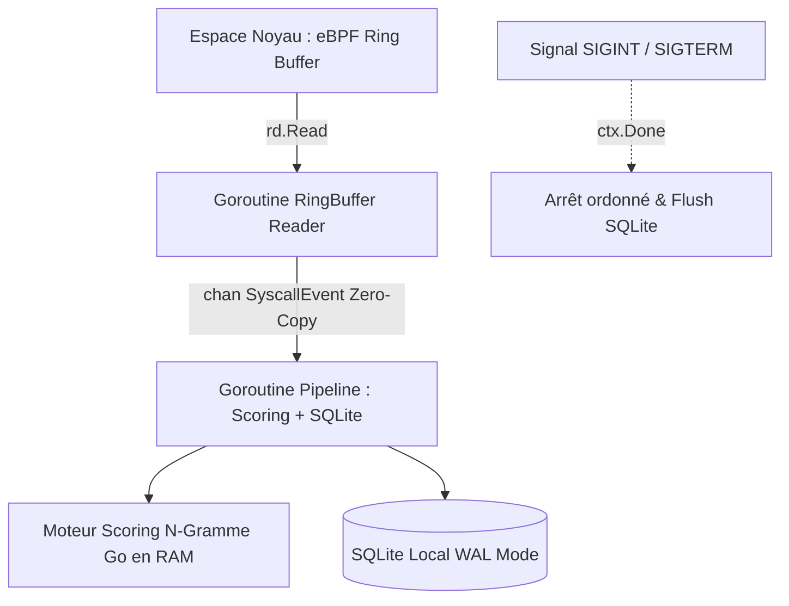

# Guide d'Architecture & Recommandations Techniques : Block-X v2

Ce document rassemble les principes directeurs, patrons de conception et recommandations d'ingénierie pour la refonte complète du système **Block-X**. L'objectif est de transformer le prototype initial en un HIDS hybride temps réel performant, robuste et académiquement irréprochable.

---

## 1. Principes de Conception & SOLID appliqués à l'Espace Noyau (eBPF en C)

Bien que le C ne soit pas un langage orienté objet, les principes **SOLID** s'appliquent fidèlement à la programmation modulaire noyau :

### 1.1 Single Responsibility Principle (SRP)
Dans le noyau, chaque programme eBPF et chaque module C doit avoir **un et un seul motif de changement** :
- **Ne pas mélanger l'enforcement (blocage) et la télémétrie** :
  - Un hook LSM doit uniquement déterminer si une action est autorisée et retourner `0` ou `-EACCES`.
  - La capture d'événements pour le scoring statistique doit être isolée dans des sondes dédiées ou confiée à un helper unique `emit_security_event()`.
- **Organisation modulaire des fichiers C** :
  - `policy_engine.h` : Définition des structures de règles et algorithmes de matching purs (aucun appel direct aux maps globales).
  - `telemetry.h` : Définition de la structure `struct event_t` transmise au Ring Buffer et fonction de formatage normalisée.
  - `maps.h` : Déclaration centralisée et typée des BPF Maps.
  - `main.bpf.c` : Points d'entrée des hooks BPF (`SEC("lsm/...")`, `SEC("fexit/...")`), qui ne font qu'orchestrer les appels aux briques ci-dessus.

### 1.2 Open/Closed Principle (OCP) & Choix des BPF Maps
Le code noyau ne doit pas être recompilé ou modifié pour ajouter des règles ou changer la volumétrie. Remplacer les structures à taille fixe (`MAX_ELEMENTS 4`) par les structures de données natives du vérificateur BPF :

1. **`BPF_MAP_TYPE_LPM_TRIE` pour les arborescences de fichiers** :
   - Plutôt que d'itérer en boucle sur un tableau de chaînes, le *Longest Prefix Match Trie* permet de faire correspondre instantanément des préfixes de répertoires (`/var/log/*`, `/etc/shadow`) en temps $O(1)$.
2. **`BPF_MAP_TYPE_TASK_STORAGE` pour le suivi par Processus / Thread** :
   - **Révolutionnaire pour la gestion mémoire** : Cette map moderne associe du contexte directement à la `task_struct` d'un processus ou thread.
   - **Zéro fuite mémoire** : Le noyau Linux détruit automatiquement la mémoire allouée dès que le thread ou processus se termine. Vous n'avez plus besoin d'écouter `sys_exit` pour nettoyer manuellement des tables de hachage.
3. **`BPF_MAP_TYPE_HASH` pour les identités de binaires** :
   - Indexer les exécutables autorisés par leur couple `(dev_t, ino_t)` (identifiant matériel de l'inode) plutôt que par leur chemin ou leur `comm`.

---

## 2. Sélection Optimale des Points d'Attache eBPF (Maximisation du Contexte)

Les tracepoints génériques (`sys_enter_*`) interceptent des pointeurs mémoire utilisateur non vérifiés, sujets aux vulnérabilités TOCTOU (*Time-of-Check to Time-of-Use*). Pour un HIDS Linux moderne ($\ge 5.8$), privilégier l'écosystème **LSM** et les **fexit** (trampolines BTF) :

| Événement système | Point d'attache recommandé | Avantages & Contexte accessible |
|---|---|---|
| **Exécution de programme** | `SEC("lsm/bprm_check_security")` | Accès direct à `struct linux_binprm *`. Fournit le fichier binaire réel (`bprm->file`), ses descripteurs, ses arguments d'exécution et les identifiants réels (`cred`). Impossible à contourner par un renommage de binaire. |
| **Accès / Ouverture de fichier** | `SEC("lsm/file_open")` | La structure `struct file *` est déjà validée par le sous-système VFS. `bpf_d_path()` résout le chemin absolu réel sans race condition. |
| **Création / Connexion réseau** | `SEC("lsm/socket_connect")` | Accès direct à `struct socket *` et `struct sock *`. Les adresses IPv4/IPv6 et ports distants sont structurés nativement en mémoire noyau (évite les manipulations manuelles de `sockaddr`). |
| **Duplication de descripteur** | `SEC("lsm/file_receive")` ou `SEC("tracepoint/syscalls/sys_enter_dup2")` | Permet d'intercepter la redirection de sockets réseau vers `stdin` (0), `stdout` (1) ou `stderr` (2), signature directe des reverse shells. |
| **Sortie d'appel système** | `SEC("fexit/__x64_sys_*")` | Beaucoup plus rapide que les `kretprobes`. Donne un accès typé aux arguments initiaux et au code de retour (`ret`) pour vérifier le succès réel de l'appel. |

---

## 3. Architecture pour un Scoring Quasiment Instantané ($< 1\text{ ms}$)

### 3.1 L'anti-pattern à supprimer : La base de données en tant que Message Broker
Dans l'ancienne version :
$$\text{eBPF} \rightarrow \text{RingBuffer} \rightarrow \text{Go Ingestion} \rightarrow \text{PostgreSQL} \xrightarrow{\text{Polling 500ms}} \text{Orchestrateur} \xrightarrow{\text{HTTP}} \text{FastAPI} \xrightarrow{\text{UPDATE}} \text{PostgreSQL}$$
Cet enchaînement induisait entre 100 ms et 1 seconde de latence et saturait le disque en requêtes SQL séquentielles.

### 3.2 L'Architecture Haute Performance : Pipeline en Mémoire Vive



### 3.3 Choix d'implémentation pour le Scoring :
1. **Recommandation n°1 : Réécrire le modèle N-gramme directement en Go (In-Process)** :
   - Un modèle $N$-gramme avec lissage Add-$k$ n'est rien d'autre qu'une table de hachage de compteurs `map[[4]uint32]map[uint32]uint64`.
   - En l'implémentant en Go dans le démon d'ingestion, le scoring d'une séquence prend **moins de 5 microsecondes** par appel.
   - Les alertes d'anomalies comportementales sont déclenchées **instantanément**, sans sérialisation JSON, sans appel réseau HTTP, et sans latence PostgreSQL.
2. **Recommandation n°2 (si conservation de Python pour l'analyse avancée)** :
   - Éliminer le polling PostgreSQL.
   - Établir une communication inter-processus continue via **Unix Domain Socket** local ou **gRPC Streaming** avec protocol buffers.
   - Le service Python garde les fenêtres de processus en RAM et répond en streaming continu.

---

## 4. Rigueur Méthodologique & Correction du Modèle de Détection

### 4.1 Prévention de l'Empoisonnement du Modèle (*Data Poisoning*)
Dans tout système d'apprentissage comportemental en ligne, le modèle ne doit **jamais** s'entraîner sur ce qu'il a classé comme anomalie :
```go
score := model.Score(sequence)
if score >= Threshold {
    // 1. Alerte déclenchée
    TriggerAlert(event, score)
    // 2. IMPORTANT : Ne PAS appeler model.Train(sequence)
    // La séquence d'attaque ne doit pas devenir la norme !
} else {
    // Comportement considéré comme normal : apprentissage sécurisé
    model.Train(sequence)
}
```

### 4.2 Initialisation du Vocabulaire du Lissage Add-$k$
- Pour éviter qu'au démarrage toute transition inconnue reçoive un score d'anomalie de $0.0$ (problème relevé dans l'ancien code), le vocabulaire initial $|V|$ ne doit pas dépendre uniquement des symboles observés dynamiquement.
- **Bonne pratique** : Initialiser le vocabulaire $|V|$ avec l'ensemble des appels système Linux x86_64 standard ($\approx 350$ à $450$ identifiants). Ainsi, même à l'état vierge, une transition non observée possède une probabilité très faible et un score d'anomalie élevé.

### 4.3 Intégrité des Séquences en Environnement Multithread
- Un processus multithreadé moderne (ex: Nginx, JVM, Go runtime) émet des appels système entrelacés sur plusieurs threads en parallèle.
- Grouper les séquences par `PID` pollue la fenêtre d'observation.
- **Règle absolue** : Les fenêtres glissantes de $N$-grammes doivent être indexées par **`TID`** (Thread ID) ou par le couple `(PID, TID)`.

---

## 5. Stratégie Académique & Valorisation pour le Mémoire (Bachelor)

Pour maximiser l'impact de ce projet lors d'une soutenance de Bachelor ou Licence, orienter le rapport et les tests autour de trois piliers fondamentaux :

### 5.1 Protocole Expérimental de Benchmarking
Ne pas se contenter d'affirmations théoriques. Fournir des métriques mesurées :
1. **Latence induite** : Mesurer le temps d'exécution d'un million d'appels système avec et sans Block-X activé.
2. **Surcharge CPU & Mémoire** : Réaliser des stress tests avec des outils reconnus de la communauté Linux :
   - `sysbench` (tests CPU et threads).
   - `wrk` ou `autocannon` sur un serveur web Nginx surveillé par Block-X.
   - `fio` pour mesurer l'impact sur le sous-système de fichiers.

### 5.2 Scénarios d'Attaque Concrets (Validation de la Sécurité)
Démontrer la double capacité du système face à des scénarios réalistes :
1. **Blocage déterministe (LSM)** :
   - Tentative de lecture de `/etc/shadow` ou de secrets d'application par un binaire non autorisé.
   - Tentative de modification de configuration en écriture seule.
2. **Détection comportementale ($N$-gramme)** :
   - Émulation d'une vulnérabilité Web exploitée menant à un reverse shell (`bash -i >& /dev/tcp/...`). Montrer comment la séquence atypique fait bondir le score d'anomalie.
   - Émulation de reconnaissance post-exploitation (énumération rapide de fichiers dans `/proc` et `/sys`).

### 5.3 Analyse Critique & Perspectives (Ce qui séduit le jury)
- Présenter ouvertement les limites de l'approche statistique pure (taux de faux positifs lors de mises à jour système volumineuses `apt update`).
- Proposer des pistes de recherche futures : transition vers des modèles de plongement de graphes de provenance (*provenance graphs*) ou architectures Transformer légères exécutées sur GPU/NPU dédié.

---

## 6. Scénario de Démonstration en Direct : Tentative d'Élévation de Privilèges

Pour la soutenance, présenter un scénario d'attaque en direct (*live demo*) confrontant l'agent attaquant aux deux lignes de défense de Block-X :

### 6.1 Déroulement de l'Attaque Simulée (Agent non privilégié UID 1001)
1. **Reconnaissance post-exploitation** : Énumération système, recherche de binaires SUID (`find / -perm -4000`), exploration de `/etc/`.
2. **Accès aux secrets** : Tentative de lecture non autorisée de `/etc/shadow` ou `/root/.ssh/id_rsa`.
3. **Exploitation & Élévation** : Tentative d'injection dans `/etc/sudoers` ou exécution de `setuid(0)` suivie de `execve("/bin/sh")`.

### 6.2 Réaction Multicouche de Block-X
1. **Ligne 1 (Noyau LSM)** : Le hook `lsm/file_open` bloque immédiatement la lecture des fichiers protégés en renvoyant `-EACCES` (*Permission Denied*), sans aucun délai d'attente.
2. **Ligne 2 (Comportement N-gramme)** : La séquence de reconnaissance atypique et l'appel `setuid(0)` font bondir le score d'anomalie statistique ($> 0.90$).
3. **Ligne 3 (Réaction Active)** : Dès franchissement du seuil, le démon Go envoie un `syscall.Kill(pid, syscall.SIGKILL)`, tuant la session de l'attaquant en direct.
4. **Mise en scène pour le jury** : Exécuter l'attaque d'abord sans Block-X (succès de l'attaquant en 3s), puis avec Block-X actif (blocage net et alerte immédiate).

---

## 7. Système d'Évaluation & Explicabilité IA (XAI - Système 1 / Système 2)

Pour pallier le caractère "boîte noire" des $N$-grammes statistiques et la fatigue d'alerte, structurer l'analyse en deux vitesses :



### 7.1 Niveau 1 (Fast Path / Réflexe en Go)
- Traite des flux massifs ($> 100\,000\text{ syscalls/s}$) en microsecondes via le modèle $N$-gramme en mémoire.
- Agit comme un filtre à haute sensibilité : ne fait remonter que les $0,1\,\%$ d'événements suspects.

### 7.2 Niveau 2 (Slow Path / Explicabilité XAI en Python)
- Sollicité **uniquement** lors d'une anomalie avérée du Niveau 1.
- Reçoit le contexte complet (PID, UID, binaire, arguments, cible, arbre généalogique).
- Produit une explication en langage naturel, la correspondance avec la matrice **MITRE ATT&CK**, et un verdict structuré (`CONFIRMED_MALICIOUS` vs `BENIGN_FALSE_POSITIVE`).

### 7.3 Boucle de Rétroaction Sécurisée (Active Learning sans Poisoning)
- **Si malveillant** : L'alerte est consignée comme attaque avérée. Le modèle de Niveau 1 **ne s'entraîne pas** sur cette séquence (prévention de l'auto-empoisonnement).
- **Si faux positif bénin** (ex: script de sauvegarde admin) : L'événement est marqué comme bénin en base de données, et l'autorisation est donnée au modèle de Niveau 1 d'apprendre cette séquence spécifique afin de ne plus jamais alerter dessus.

---

## 8. Remédiation Dynamique et BPF Maps (Perspective & Sécurité)

### 8.1 Pourquoi limiter ce volet aux "Perspectives" du mémoire
Donner à une IA le pouvoir de modifier arbitrairement les règles noyau sans garde-fous introduit un risque de **Déni de Service Auto-Infligé (*Self-DoS*)** (ex: bannissement accidentel de `systemd` ou `sshd`) et expose le système aux attaques adverses. Dans le cadre d'un Bachelor, concevoir ce mécanisme de manière théorique et documentée dans le mémoire est la stratégie la plus judicieuse.

### 8.2 Schéma de Bannissement Léger via BPF Map
Pour une preuve de concept minimale, un bannissement dynamique ne nécessite que quelques lignes :
- **Espace Noyau** : Une map `BPF_MAP_TYPE_HASH` nommée `dynamic_blocklist`. Le hook LSM vérifie si le PID/UID y figure et retourne `-EPERM`.
- **Espace Utilisateur** : Le démon Go insère la clé dès validation de l'attaque : `loader.DynamicBlocklist.Put(attackerPID, uint8(1))`.
- **Garde-fous indispensables** : Exclusion absolue et codée en dur des processus vitaux (PID 1, root, daemons système essentiels).

---

## 9. Optimisation d'Ingénierie des Coûts & Réduction des Tokens (XAI)

L'intégration d'un LLM dans un flux de logs système peut saturer un budget d'API en quelques heures sans une politique stricte d'efficience :

### 9.1 Les 5 Stratégies de Réduction de Tokens (Économie de 99,99 %)

1. **Coalescence d'Alertes (*Alert Debouncing*)** :
   - Regrouper tous les syscalls suspects d'un même PID sur une fenêtre temporelle glissante (2 à 5 secondes).
   - Au lieu de 100 requêtes unitaires, envoyer **un seul appel groupé** pour l'ensemble de la cinématique d'attaque.
2. **Compression Sémantique du Prompt** :
   - Bannir les formats JSON verbeux non épurés.
   - Utiliser une syntaxe condensée dense :
     ```text
     CTX: apache2[4120] uid:33 parent:systemd
     TRACE: socket(INET) -> connect(10.0.0.5:4444) -> dup2(sock->stdin) -> exec(/bin/sh)
     ```
   - Divise la consommation de tokens par un facteur 10.
3. **Cache d'Empreintes (*Alert Fingerprinting*)** :
   - Calculer `SHA256(comm + syscall_sequence)`.
   - Si l'empreinte a déjà été analysée récemment (ex: tâche cron quotidienne), réutiliser le verdict en mémoire sans interroger le modèle.
4. **Moteur Hybride (Règles Déterministes d'abord)** :
   - Résoudre 80 % des attaques évidentes (lecture directe de `/etc/shadow`, shell spawné depuis Apache) via des heuristiques locales (coût : **0 token**).
   - Réserver l'appel au modèle pour les 20 % de cas sémantiquement ambigus.
5. **Alternative Locale : Petits Modèles Spécialisés (SLM)** :
   - Déployer un modèle local compact (1B à 3B paramètres type *Llama-3.2-1B/3B*, *Qwen2.5-Coder-1.5B/3B* ou *Phi-3.5-mini*) via **Ollama** ou **llama.cpp**.
   - **Avantages majeurs** : Coût d'API nul (**0 € / 0 token**), confidentialité totale (les traces d'appels système ne quittent jamais le serveur), et fonctionnement 100 % hors-ligne.

---

## 10. Estimation de la Durée de l'Attaque en Nombre d'Appels Système (*Attack Horizon*)

Mesurer la durée d'une attaque en secondes ou millisecondes est trompeur sur un système d'exploitation : un script automatisé exécute 50 syscalls en 3 ms alors qu'un attaquant humain met 2 minutes pour taper les mêmes commandes. **Le nombre de syscalls constitue une métrique scale-invariant, indépendante de la vitesse CPU et de la charge machine.**

### 10.1 Algorithme à Double Seuil (*Change-Point Detection*)
Pour dater le début exact d'une attaque avant son apogée critique, utiliser deux seuils statistiques :
1. **Seuil de Vigilance ($\theta_{\text{warn}} \approx 0,40$)** : Marque le premier décrochage suspect par rapport au profil nominal (reconnaissance, socket atypique).
2. **Seuil Critique d'Alerte ($\theta_{\text{alert}} \approx 0,85$)** : Déclenche l'alerte d'incident majeur (escalade de privilèges, exécution de shell).

$$\text{Durée}_{\text{syscalls}} = \text{Index}_{\text{Alerte}} - \text{Index}_{\text{Début}} + 1$$

### 10.2 Structure de Suivi par Thread (Go)
```go
type ProcessTraceState struct {
    TID             uint32
    SyscallCount    uint64    // Compteur monotone d'appels système exécutés par ce thread
    AttackStartIdx  uint64    // Index du premier syscall ayant franchi theta_warn (0 si nominal)
    SuspectCount    uint32    // Nombre d'appels consécutifs suspects
    SlidingWindow   [5]uint32 // Fenêtre N-gramme
}
```

### 10.3 Apport Majeur pour le Triage XAI et la Forensique
L'enrichissement de l'alerte transmise au modèle de Niveau 2 avec cette métrique permet de générer des rapports forensiques ultra-précis :
- **Entrée XAI** : `ATTACK DURATION: 18 syscalls (début: syscall #1342, alerte: syscall #1360)`.
- **Restitution Analyste / Jury** :
  > *"L'attaque s'est étalée sur une trajectoire de **18 appels système**. La divergence a débuté lors de l'ouverture de socket (syscall #1342), s'est poursuivie sur 16 redirections de descripteurs (dup2), avant de culminer avec le spawn du shell root (syscall #1360)."*

---

## 11. Refonte d'Architecture : Binaire Go Unique, Scoring In-Process & SQLite

Pour éliminer définitivement la latence inter-processus et la complexité opérationnelle d'orchestration multi-services, l'architecture converge vers **un démon Go unique** :



### 11.1 Suppression de l'Orchestrateur & Élimination de la Latence IPC
- **Problème initial** : La séparation en exécutables distincts (`ebpf-tool`, `orchestrator`, API Python) nécessitait du polling SQL, des sérialisations JSON et des requêtes HTTP réseau locales, introduisant entre 100 ms et 1 s de latence.
- **Solution retenue** : Intégration dans un seul processus Go.
  - La communication entre la capture d'événements et le scoring s'effectue via un simple canal Go bufferisé (`chan SyscallEvent`, capacité de 10 000).
  - Latence de transfert : **~0 nanoseconde** (simple passage de pointeur en mémoire vive sans syscall ni copie).

### 11.2 Portage du Scoring Python vers Go (`pkg/scoring`)
- L'algorithme N-Gramme avec lissage Add-$k$ est implémenté nativement en Go dans le package partagé `pkg/scoring`.
- **Gains majeurs** :
  - Vitesse d'évaluation : $< 5\ \mu\text{s}$ par séquence.
  - Suppression complète du runtime Python, de son garbage collector et des dépendances d'API externes pour la boucle critique.
  - Sauvegarde et restauration simples de l'état du modèle (vocabulaire et fréquences de transitions) sous forme de fichier binaire ou d'enregistrement SQLite local.

### 11.3 Remplacement de PostgreSQL par SQLite (Mode WAL)
- Remplacement du serveur lourd PostgreSQL par une base de données embarquée **SQLite** locale (via driver pur Go `modernc.org/sqlite` ou `mattn/go-sqlite3`).
- **Configuration optimale pour HIDS** :
  ```sql
  PRAGMA journal_mode = WAL;
  PRAGMA synchronous = NORMAL;
  PRAGMA temp_store = MEMORY;
  PRAGMA cache_size = -64000; -- 64MB de cache
  ```
- **Avantages** :
  - **Zéro infrastructure** : Aucun conteneur Docker ou serveur PostgreSQL à démarrer.
  - **Concurrence sans blocage** : Le mode WAL (*Write-Ahead Logging*) autorise des lecteurs simultanés pendant que la goroutine de télémétrie écrit les événements par lots (*batch transactions*).

### 11.4 Monorepo Go & Mutualisation des Packages (`go.mod` Unique)
- Unification de l'arbre du projet autour d'un **seul `go.mod` à la racine** (`github.com/dstm45/block-x`).
- Structure cible :
  ```text
  block-x/
  ├── go.mod                     # Module unique github.com/dstm45/block-x
  ├── cmd/
  │   └── block-x/
  │       └── main.go            # Point d'entrée central unifié
  ├── pkg/                       # Packages mutualisés
  │   ├── database/              # Wrapper SQLite, migrations et requêtes
  │   ├── scoring/               # Moteur N-gramme Go in-process
  │   └── config/                # Chargement de la configuration
  └── internal/                  # Code eBPF & helpers internes
      ├── ebpf/                  # Code source C eBPF et bindings bpf2go
      └── ebpfutils/             # Helpers eBPF, lecture ringbuf
  ```


